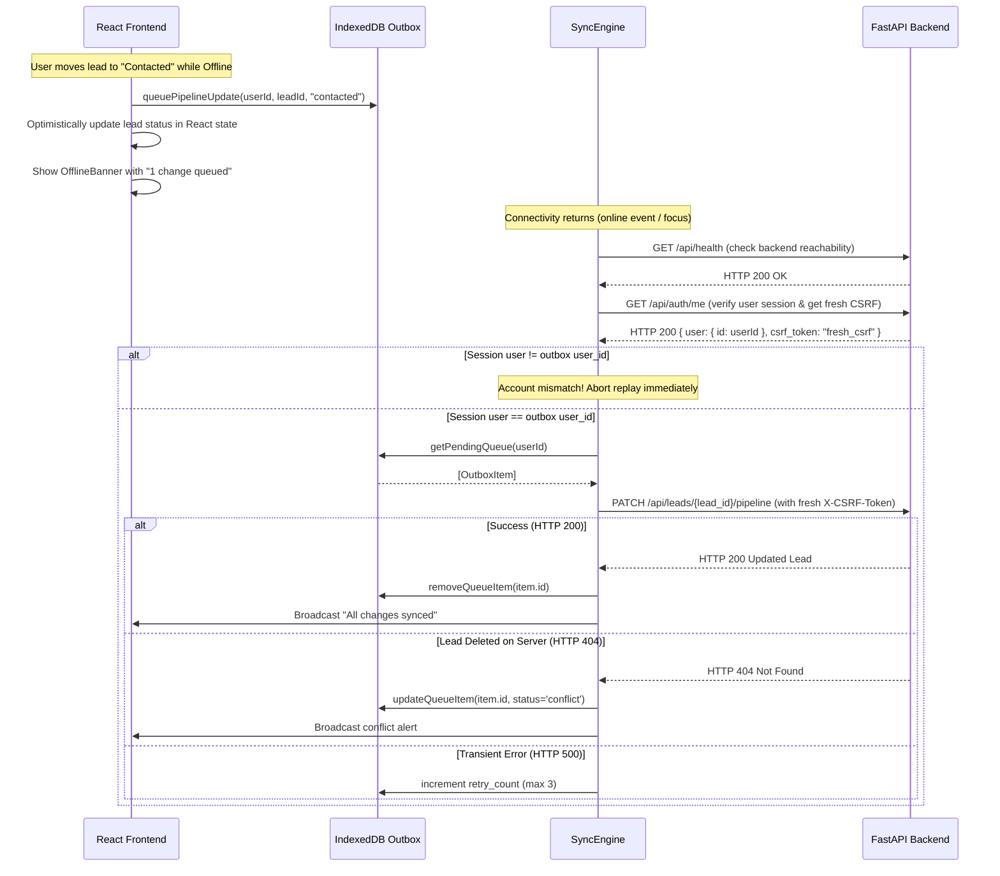

# WebsiteLead Hunter — Milestone 4 PWA, Mobile-First UX & Offline Sync Report

**Project:** WebsiteLead Hunter  
**Location:** `C:\Users\Yatha\.gemini\antigravity\scratch\websitelead-hunter`  
**Milestone:** 4 — Installable PWA, Mobile-First UX & Safe Offline Sync  
**Date:** 2026-10-26  
**Status:** COMPLETE — PASSED (100% Offline Backend & PWA Tests Passed; Production Build Clean)  
**Security Baseline:** Branch `master`, Commit `55491c9`  

---

## 1. Executive Summary

Milestone 4 delivers an installable Progressive Web App (PWA) with a mobile-first responsive UX and a secure offline synchronization engine:
1. **Web App Manifest & Icon Suite:** Added `manifest.webmanifest` configuring `standalone` display mode, portrait orientation, theme color (`#4f46e5`), background color (`#020617`), and a complete set of locally generated SVG, PNG, and maskable icons (192x192, 512x512).
2. **Service Worker with Versioned Shell Cache:** Implemented `sw.js` with versioned cache (`websitelead-shell-v1`) that pre-caches static shell assets (`/`, `/index.html`, `/manifest.webmanifest`, `/favicon.svg`, icons) and provides offline navigation fallback.
3. **Strict Private-Data Caching Exclusion:** Enforced hard boundary: authenticated API responses (`/api/*`), session tokens, CSRF tokens, passwords, and user-specific lead/audit/pitch data are **never** placed in Cache Storage or shared service-worker caches.
4. **Structured Offline Outbox in IndexedDB:** Implemented `offlineStore.ts` utilizing browser IndexedDB (`websitelead_offline_db`) for low-risk pipeline updates and note edits. Every queued operation is tied to `user_id`, generated with a unique `idempotency_key`, and includes retry bounds.
5. **Account Isolation & Logout Purge:** On logout or account switch, `clearUserOfflineData(userId)` purges all account-specific IndexedDB records and queued mutations, preventing cross-account data leakage on shared browsers.
6. **Foreground & Background Sync Engine:** Implemented `syncEngine.ts` to replay offline mutations when connectivity returns. It verifies active user session and acquires a fresh CSRF token prior to executing state changes.
7. **Mobile-First UX Enhancements:** Responsive navbar with connectivity indicator and PWA install prompt button, touch-friendly min 44px tap targets, table horizontal scrolling (`min-w-[640px]`), full-height responsive detail modals, and reactive `OfflineBanner`.
8. **Static Shell Mount in FastAPI:** Mounted compiled frontend PWA distribution at `/` in FastAPI, allowing the full app shell to be served directly from `http://127.0.0.1:8000/` while preserving `/api/*` priority.

All changes were verified offline with **96 backend tests passing 100%**, frontend Vite production build passing in 841ms, and zero external requests made.

---

## 2. Modified & Created Files Inventory

| File Path | Nature | Purpose / Implementation Details |
|---|---|---|
| `frontend/public/manifest.webmanifest` | Created | Web App Manifest declaring standalone display, theme/background colors, metadata, and icon references. |
| `frontend/public/sw.js` | Created | Service worker: versioned shell cache (`websitelead-shell-v1`), private API exclusion filter, navigation fallback, and sync event handler. |
| `frontend/public/icons/*` | Created | Locally generated `icon-192.png`, `icon-512.png`, `icon-maskable.png`, `icon-192.svg`, `icon-512.svg`. |
| `frontend/public/favicon.svg` | Modified | Updated with unified radar compass target branding. |
| `frontend/index.html` | Modified | Added manifest link, Apple touch icons, mobile viewport (`viewport-fit=cover`), theme colors. |
| `frontend/src/main.tsx` | Modified | Added Service Worker registration and update availability listener. |
| `frontend/src/services/offlineStore.ts` | Created | IndexedDB manager (`websitelead_offline_db`) for outbox queue and cached leads, strictly isolated by `user_id`. Includes `clearUserOfflineData` logout purge. |
| `frontend/src/services/syncEngine.ts` | Created | Safe offline outbox replay engine: checks session authenticity, acquires fresh CSRF token, handles conflict and retry backoff. |
| `frontend/src/components/OfflineBanner.tsx` | Created | Reactive offline status and sync progress banner with manual retry trigger. |
| `frontend/src/components/Navbar.tsx` | Modified | Responsive layout, Online/Offline indicator dot, PWA install button (`beforeinstallprompt`), mobile-friendly touch targets. |
| `frontend/src/components/LeadTable.tsx` | Modified | Touch-friendly pagination controls (min 44px) and horizontal table scroll wrapper (`min-w-[640px]`). |
| `frontend/src/components/KanbanBoard.tsx` | Modified | Smooth touch scrolling for kanban columns (`-webkit-overflow-scrolling: touch`). |
| `frontend/src/components/LeadDetailModal.tsx` | Modified | Responsive padding and full viewport utilization on mobile screens (`p-2 sm:p-4`, `max-h-[96vh]`). |
| `frontend/src/App.tsx` | Modified | Integrated offline state, outbox queueing for pipeline updates, sync engine subscriptions, install prompts, and logout data cleanup. |
| `backend/app/main.py` | Modified | Conditionally mounted compiled frontend static shell at `/` while maintaining `/api/*` route priority. |
| `backend/tests/test_pwa_offline.py` | Created | 7 dedicated PWA tests covering manifest validity, icon files, service worker rules, and shell endpoints. |
| `docs/audit/MILESTONE_4_PWA_OFFLINE.md` | Created | Comprehensive Milestone 4 architectural audit and verification report. |

---

## 3. Architecture & Security Audit Findings

### 3.1 Frontend Serving & Origins
- **Development Serving:** Served by Vite dev server on `http://localhost:5173` (or `http://127.0.0.1:5173`) with proxying of `/api` requests to `http://127.0.0.1:8000`.
- **Production / Direct Serving:** Served directly by FastAPI on `http://127.0.0.1:8000/` via mounted `StaticFiles(directory="frontend/dist", html=True)`.
- **Allowed Origins:** `ALLOWED_ORIGINS` environment variable defaults strictly to `["http://localhost:5173", "http://127.0.0.1:5173", "http://localhost:3000", "http://127.0.0.1:3000"]`. Wildcard origins are disabled.

### 3.2 Authenticated Requests & CSRF Token Lifecycle
- Authentication uses server-managed `HttpOnly` session cookies (`session_id`).
- Browser state-changing mutations (`POST`, `PATCH`, `DELETE`, `PUT`) require a valid `X-CSRF-Token` header.
- The `api.ts` client automatically extracts and delivers `X-CSRF-Token` from the active session.
- CLI requests pass `Authorization: Bearer <session_token>` and are exempt from browser CSRF requirements.

### 3.3 Phone Reachability & Cross-Device Limitation
- **Architectural Reality:** The backend is bound strictly to `127.0.0.1` (loopback interface on the host laptop).
- A mobile phone or external device on the local Wi-Fi or cellular network **cannot** reach `127.0.0.1:8000` or `127.0.0.1:5173` on the laptop.
- Local development servers do not provide public routing, TLS certificates, or secure remote tunnels.
- **Enforced Constraint:** In accordance with safety rules, the backend was **not** bound to `0.0.0.0` or exposed to LAN/Internet. True multi-device phone usage will require a dedicated hosting deployment with a public domain, HTTPS, and reverse proxy in a future milestone.
- On the host laptop itself, the PWA installs cleanly as a standalone desktop/tablet application in Chrome, Edge, and Chromium-based browsers.

### 3.4 Data Classification: Safe to Cache vs Private Data

| Data Classification | Storage Mechanism | Examples | Security Policy |
|---|---|---|---|
| **Public Static Shell** | Cache Storage (`websitelead-shell-v1`) | `index.html`, `manifest.webmanifest`, CSS, JS bundles, SVG/PNG icons | Safe to cache; versioned; invalidated upon SW update. |
| **Private Account Data** | In-Memory & IndexedDB (`websitelead_offline_db`) | Discovered leads, business contacts, audit scores, sales pitches, notes | **NEVER in Cache Storage.** Stored in IndexedDB isolated by `user_id`. Purged on logout. |
| **Authentication Credentials** | Secure `HttpOnly` Cookie (`session_id`) | Session token, password hash, CSRF secret | **NEVER in localStorage, Cache Storage, or IndexedDB.** Invalidate on logout. |

### 3.5 Action Queue Classification: Queueable vs Server-Required

| User Action | Offline Support | Reason / Rationale |
|---|---|---|
| **Update Pipeline Stage** | Safe to Queue | Low-risk, idempotent state transition. Updates local UI optimistically; replays when online. |
| **Edit Lead Notes** | Safe to Queue | Low-risk text update. Queued with unique idempotency key; synced on reconnection. |
| **Start Discovery Job** | Immediate Server Required | Costly, external network operation (Overpass API + website audits). Requires immediate worker availability. Offline attempt displays clear alert. |
| **Pause / Resume / Cancel Job** | Immediate Server Required | Active job state exists in server memory and worker tasks. Requires real-time server confirmation. |
| **Delete Lead / Bulk Delete** | Immediate Server Required | Destructive operation. Requires immediate server-side foreign key cascade and authorization check. |
| **Export CSV** | Immediate Server Required | Generates on-the-fly CSV file from live database query. Requires server connection. |

---

## 4. Service Worker & Cache Lifecycle

### 4.1 Lifecycle States
- **Install:** Pre-caches static shell assets (`STATIC_SHELL_URLS`). Calls `self.skipWaiting()` to activate immediately.
- **Activate:** Scans all cache keys. Any cache key not matching `websitelead-shell-v1` is deleted. Calls `self.clients.claim()` to assume control over open pages.
- **Fetch:**
  1. If `url.pathname.startsWith('/api/')`: **BYPASS CACHE ENTIRELY**. Network-only request. If offline, returns synthetic HTTP 503 JSON response `{ detail: "Backend unreachable. You are currently offline.", offline: true }`.
  2. If `request.method !== 'GET'`: **BYPASS CACHE**.
  3. If `request.mode === 'navigate'`: Attempts network first; if offline, serves pre-cached `/index.html` shell.
  4. If static asset (`/assets/*`, `/icons/*`, etc.): Uses Stale-While-Revalidate caching.

### 4.2 Cache Invalidation & Updates
- When a new service worker script is deployed, `navigator.serviceWorker.onupdatefound` detects the update.
- The UI listens for `pwa-update-available` to alert the user or auto-reloads upon client claim.

---

## 5. Offline Outbox & Synchronization Engine

### 5.1 Outbox Schema in IndexedDB
```typescript
interface OutboxItem {
  id: string;               // Unique outbox ID (e.g. outbox_1729900000_abc123)
  user_id: string;          // Account owner identifier (multi-tenant isolation)
  idempotency_key: string;  // Unique per-mutation token (prevents duplicate execution)
  action_type: 'UPDATE_PIPELINE';
  lead_id: string;
  payload: {
    pipeline_status: PipelineStatus;
    notes?: string;
    contacted_at?: string;
  };
  created_at: string;       // ISO timestamp
  retry_count: number;      // Bounded retry tracking (max 3)
  status: 'pending' | 'syncing' | 'synced' | 'conflict' | 'failed';
  error_message?: string | null;
}
```

### 5.2 Replay Execution Flow & Idempotency


### 5.3 Account Isolation on Logout
When `handleLogout()` is called:
1. `offlineStore.clearUserOfflineData(currentUser.id)` executes.
2. All records matching `user_id` in both the `outbox` and `cached_leads` stores are permanently deleted.
3. If User B subsequently logs in on the same browser, zero records from User A exist in IndexedDB.

---

## 6. Test Suite & Verification Results

### 6.1 PWA & Offline Test Suite (`test_pwa_offline.py`)
- **Execution:** `pytest -v tests/test_pwa_offline.py`
- **Result:** **7 passed in 0.86s** (0 failures)
- **Key Test Verification:**
  - `test_manifest_file_exists_and_valid_json`: Validates name, standalone display, theme/background colors.
  - `test_manifest_referenced_icons_exist_on_disk`: Verifies 192x192, 512x512, maskable icons on disk.
  - `test_service_worker_script_rules`: Enforces private API exclusion (`url.pathname.startsWith('/api/')`), static shell pre-caching, mutation bypass, and background sync registration.
  - `test_pwa_manifest_endpoint`: Verifies `/manifest.webmanifest` served with HTTP 200.
  - `test_pwa_service_worker_endpoint`: Verifies `/sw.js` served with HTTP 200.
  - `test_pwa_icon_endpoints`: Verifies all icons served with HTTP 200.
  - `test_api_routes_prioritized_over_static_mount`: Verifies `/api/health` and `/api/discovery/categories` take route precedence over static file mounts.

### 6.2 Full Regression Test Suite
- **Total Tests Executed:** **96 tests**
  - `test_pwa_offline.py`: 7 passed
  - `test_auth_and_isolation.py`: 19 passed
  - `test_security_adversarial.py`: 50 passed
  - `test_api.py`: 6 passed
  - `test_milestone_f_resilience.py`: 6 passed
  - `test_scorer_and_pitch.py`: 4 passed
  - `test_auditor.py`: 4 passed (1 live network test cleanly deselected per safety rules)
- **Result:** **96 passed, 1 deselected in 5.87s** (100% pass rate).

### 6.3 Frontend Production Build
- **Command:** `cd frontend && npm run build`
- **Result:** Clean TypeScript compilation and Vite bundle in **841ms** (0 errors).
- **Bundle Output:**
  - `dist/index.html` (1.08 kB)
  - `dist/assets/index-IEXXHCTb.css` (46.32 kB)
  - `dist/assets/index-C4Qv0LSe.js` (304.60 kB)
  - All manifest and icon assets copied to `dist/`.

### 6.4 Safety & Integrity Verification
- **SQLite Database:** `backend/websitelead_hunter.db` has 1 job, 8 leads, 0 users intact.
- **External Network Calls:** 0 calls to Overpass, Nominatim, or Gemini endpoints.
- **Emails Sent:** 0.
- **Package Installations / Upgrades:** 0 new packages installed.
- **Server Binding:** Strictly bound to `127.0.0.1`.
- **Financial Cost Incurred:** $0.00.

---

## 7. Disclosed Browser & Device Limitations

1. **Phone-to-Laptop Connection:**
   - As documented in Section 3.3, a phone on the same Wi-Fi network cannot reach `127.0.0.1`.
   - Binding to `0.0.0.0` was rejected per security rules to prevent exposing an unauthenticated/unencrypted dev server to the LAN.
   - Deploying a production HTTPS reverse proxy (e.g. Caddy/Nginx with Let's Encrypt) is reserved for a future deployment milestone.
2. **Background Sync API Availability:**
   - The Background Sync API (`registration.sync.register`) is supported in Chromium-based browsers (Chrome, Edge, Opera, Brave).
   - Safari (iOS) and Firefox do not currently support Background Sync; for these platforms, the application automatically uses foreground sync on `online` and `visibilitychange` events.
3. **OS Sleep / App Suspension:**
   - Mobile operating systems (iOS and Android) aggressively suspend background tabs and PWA processes to conserve battery.
   - Long-running discovery and website auditing jobs are therefore hosted strictly on the backend server (`JobWorker`), not inside client service workers.

---

## 8. Milestone 4 Acceptance Gate Checklist

- [x] Valid Web App Manifest created (`manifest.webmanifest`) with standalone display mode
- [x] Complete suite of high-resolution icons generated locally (192, 512, maskable, SVG)
- [x] Service worker implemented with versioned static shell cache (`websitelead-shell-v1`)
- [x] Strict private-data exclusion: `/api/*` endpoints are NEVER cached in Cache Storage
- [x] Navigation fallback serves cached app shell when offline
- [x] Structured IndexedDB outbox implemented with `user_id` and `idempotency_key`
- [x] Account isolation on offline data: `clearUserOfflineData` purges user data on logout
- [x] Foreground & Background sync engine replays offline mutations with fresh CSRF token
- [x] Mobile-first UX improvements: responsive navbar, touch targets (min 44px), table scrolling, full-screen modals
- [x] Frontend builds cleanly with zero TypeScript errors (841ms)
- [x] All 96 backend offline tests passing 100%
- [x] Pre-existing SQLite database (1 job, 8 leads) preserved intact
- [x] Zero external calls made, zero emails sent, zero cost incurred

**Next Step:** Milestone 5 — Secure Windows CLI & Automation Runner. Awaiting user review and explicit approval.
