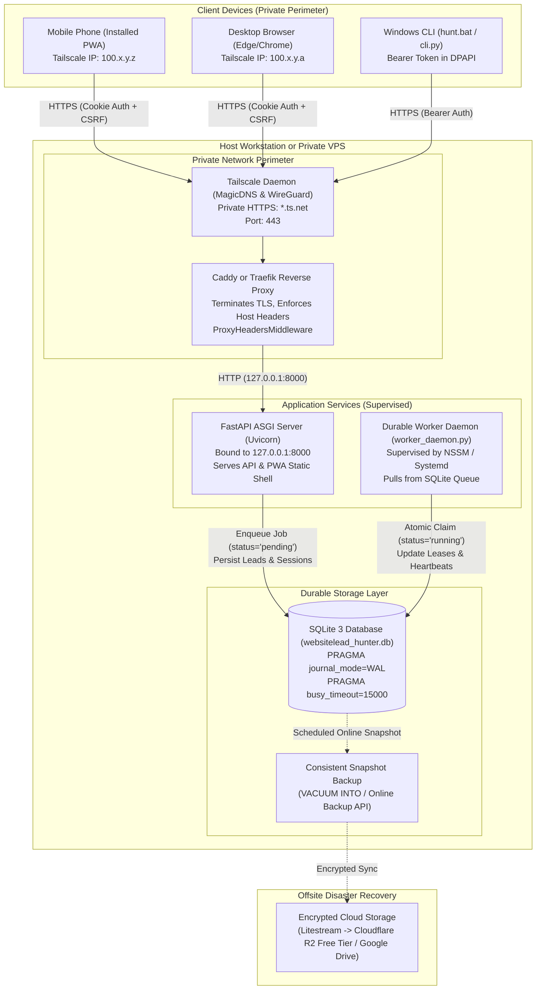

# WebsiteLead Hunter — Milestone 9A: Production Architecture Validation

**Date:** October 26, 2026  
**Auditor:** Principal Security & Cloud Systems Architect  
**Workspace:** `C:\Users\Yatha\.gemini\antigravity\scratch\websitelead-hunter`  
**Target Milestone:** Milestone 9A (Analysis & Architecture Validation Only)  
**Safety Mandate:** Zero cloud provisioning, zero network calls, zero code modifications, zero database mutations, zero Git commits.  

---

## 1. Executive Recommendation and Alternatives

### 1.1 Executive Summary
WebsiteLead Hunter currently operates as a hardened, multi-client, loopback-only application (`127.0.0.1:8000`) supporting a desktop browser interface, a mobile-friendly installable PWA, and a native Windows CLI. All components share a common SQLite database with WAL mode, cryptographic request fingerprinting, account isolation, and double-submit CSRF defenses.

To enable **seamless, private multi-device access** (owner's phone PWA, desktop browser, and Windows CLI) at **₹0/month operational cost**, this assessment evaluates two primary architecture models:
1. **Primary Recommendation: Existing-PC Fallback with Tailscale Private Mesh VPN (Actual ₹0/month Guaranteed)**
2. **Alternative: Cloud-Hosted Always-Free VPS (Oracle Cloud Infrastructure Always Free / Google Cloud e2-micro)**

### 1.2 Comparison Matrix

| Evaluation Dimension | Primary Recommendation: Existing-PC + Tailscale | Alternative: OCI Always Free VPS | Alternative: GCP e2-micro VPS |
| :--- | :--- | :--- | :--- |
| **Monetary Cost** | **₹0/month** (Zero infrastructure fees) | **₹0/month** (Nominally within Always Free) | **₹0/month** (Nominally within Always Free) |
| **Credit Card Requirement** | **None** (Uses existing hardware & free Tailscale tier) | **Mandatory** (Credit card required for account verification) | **Mandatory** (Credit card required for account verification) |
| **Capacity / Provisioning Risk** | **Zero** (Hardware is already owned and operational) | **High** (ARM Ampere / AMD Always Free instances routinely report "Out of Capacity" in Indian/US regions) | **Low to Moderate** (e2-micro generally available in select US regions) |
| **Reclamation Risk** | **Zero** (Local PC cannot be reclaimed by a cloud vendor) | **High** (Oracle terminates instances deemed "idle" with <20% CPU/RAM for 7 days) | **Low** (No idle reclamation, but accidental billable egress risks exist) |
| **Compute & Memory** | **High** (Native multi-core x86_64, 16GB+ RAM, fast NVMe) | **Very High** (Up to 4 OCPU, 24GB RAM on ARM) or **Low** (1 OCPU 1GB RAM AMD) | **Severely Constrained** (2 vCPU, 1GB RAM; risks OOM crashes during concurrent audits) |
| **PWA Mobile HTTPS** | **Automated** (Tailscale MagicDNS + Automated Let's Encrypt TLS) | **Automated** (Caddy / Certbot via public DNS or Tailscale) | **Automated** (Caddy / Certbot via public DNS or Tailscale) |
| **Attack Surface** | **Zero Public Exposure** (Bound only to `tailscale0` / loopback) | **Zero Public Exposure** if Tailscale used; **High** if exposed to public internet | **Zero Public Exposure** if Tailscale used; **High** if exposed to public internet |
| **Primary Limitation** | PC must remain powered on / awake during crawler jobs | Cloud signup hurdles, capacity waits, idle shutdown policies | 1GB RAM bottleneck; 1GB egress limit per month |

### 1.3 Strategic Recommendation
**Adopt the Existing-PC Fallback architecture powered by a Tailscale private mesh as the immediate, risk-free deployment target.**  
- It requires zero billing verification, incurs zero monetary cost, avoids cloud instance reclamation policies, and leverages the superior memory and CPU resources of the owner's workstation.
- It achieves identical mobile PWA installability and remote CLI operation via encrypted WireGuard tunnels (`*.ts.net`) with automated Let's Encrypt HTTPS certificates.
- If 24/7 autonomous cloud execution is later mandated by the owner, the containerized architecture designed in this report can be deployed to an Always Free VPS without architectural rework.

---

## 2. Current-State Findings (Codebase Audit)

Every architectural subsystem of the current repository was audited against actual source code files and line numbers.

### 2.1 FastAPI Startup, Binding, CORS, Authentication, Sessions, and CSRF
- **Entry Point & Lifespan:** `backend/app/main.py` (lines 19–27)  
  - FastAPI `lifespan` runs `init_db()`, executes `worker_instance.recover_interrupted_jobs()`, and registers the worker via `jobs.set_worker(worker_instance)`.
  - Default binding in `__main__` (lines 74–78) defaults to `HOST="127.0.0.1"` and `PORT=8000`.
- **CORS Configuration:** `backend/app/main.py` (lines 36–50)  
  - Allowed origins default to `http://localhost:5173,http://127.0.0.1:5173,http://localhost:3000,http://127.0.0.1:3000`.
  - Explicit allowed headers include `Content-Type`, `Authorization`, `Accept`, `X-Requested-With`, `X-CSRF-Token`, and `Idempotency-Key`. Credentials are enabled (`allow_credentials=True`).
- **Static PWA Shell Hosting:** `backend/app/main.py` (lines 68–72)  
  - Mounts compiled `frontend/dist` directly at root (`/`) via `StaticFiles(directory=frontend_dist, html=True)` if the directory exists, enabling unified single-port hosting.
- **Authentication & Password Storage:** `backend/app/auth/security.py` (lines 60–105)  
  - Passwords hashed with `scrypt` (`N=16384, r=8, p=1`, 16-byte cryptographically secure random salt, 32-byte derived key).
  - Timing-safe verification uses `hmac.compare_digest`. Dummy hash calculation (`dummy_password_hash_check`) mitigates user-enumeration timing leaks.
  - Rate limiting (lines 28–35, 124–148) enforces a maximum of 5 failed attempts per 300 seconds per IP or email using an in-memory dictionary (`_failed_attempts`).
- **Session Model & Token Storage:** `backend/app/auth/dependencies.py` (lines 20–88)  
  - Dual authentication extraction: checks `session_id` HttpOnly cookie first (browsers/PWA), then falls back to `Authorization: Bearer <token>` (CLI/API).
  - Server-side validation against `sessions` table joined with `users`. Expired sessions (`expires_at < now`, 7-day TTL) are automatically purged on access.
- **CSRF Defense:** `backend/app/auth/dependencies.py` (lines 103–128)  
  - Double-submit cookie pattern: browser clients receive readable `csrf_token` cookie and must submit `X-CSRF-Token` header on state-changing requests (`POST`, `PATCH`, `DELETE`, `PUT`).
  - Bearer token requests (used by the Windows CLI) are explicitly exempt from CSRF checks because custom `Authorization` headers cannot be attached cross-origin by web browsers without preflight CORS approval.

### 2.2 SQLite Connection Handling, Migrations, WAL Mode, and Storage
- **Database Engine:** `backend/app/database.py` (lines 10–35)  
  - Path configured via `DATABASE_PATH` env var (defaults to `websitelead_hunter.db`).
  - Connection flags: `check_same_thread=False`, `timeout=15.0`.
  - PRAGMAs enforced on every connection: `PRAGMA foreign_keys = ON;` and `PRAGMA journal_mode = WAL;`.
  - Context manager `get_db()` yields connection, commits upon clean block exit, rolls back on exception, and closes in a `finally` block.
- **Versioned Migration Engine:** `backend/app/migrations.py` (lines 181–210)  
  - Tracks applied migrations in `schema_migrations` table (`version`, `name`, `applied_at`).
  - Migration v1: Multi-tenant `users`, `sessions`, `user_id` on jobs and leads with composite uniqueness `(user_id, provider_id)`.
  - Migration v2: `idempotency_keys` table with compound primary key `(user_id, key)` and TTL expiration index.
  - Migration v3: Non-destructive addition of `request_fingerprint TEXT` to `idempotency_keys`.
  - Idempotency storage persists full `JobResponse` JSON, HTTP status 200, incoming SHA-256 fingerprint, and 24-hour expiration timestamp.

### 2.3 Job Creation, Claims, States, Cancellation, and Worker Lifecycle
- **Idempotency & Reservation:** `backend/app/api/jobs.py` (lines 40–195)  
  - Computes canonical SHA-256 fingerprint over location (lowercase stripped), radius (4 decimal places), sorted categories, max leads, and filter booleans.
  - Inserts `PENDING` reservation row. In-flight collisions from competing threads with differing payloads are immediately rejected with `409 Conflict`. Identical requests poll for up to 2.5s and return the leader's completed job response.
  - Exceptions during job creation cleanly delete the `PENDING` reservation to allow client retries.
- **Current Worker Lifecycle:** `backend/app/queue/job_worker.py` (lines 43–70, 186–200)  
  - **In-Process Limitation:** Jobs are spawned as in-process `asyncio.Task` instances within the Uvicorn web server process.
  - Active execution state is tracked in Python memory dictionaries: `self._running_tasks`, `self._pause_events`, and `self._cancel_flags`.
- **Restart Recovery Behavior:** `backend/app/queue/job_worker.py` (lines 70–94)  
  - On application startup, `recover_interrupted_jobs()` updates any `running` or `pending` jobs in SQLite to `paused` with an explanatory log entry.
  - **Re-run Prevention Policy:** `backend/app/api/jobs.py` (lines 319–324) and `tests/test_job_orchestration.py` (lines 335–376) prove that resuming an interrupted job from a previous server restart returns `409 Conflict` because the in-memory task is lost. Interrupted jobs can only be cancelled; they cannot resume execution.

### 2.4 Client Base URLs and Authentication Methods
- **Web PWA & Desktop Browser:**
  - File: `frontend/src/services/api.ts` (lines 3–80)
  - Base URL: `const BASE_URL = '/api';` (relative path). When served from the same origin, requests avoid CORS entirely.
  - Auth Method: `credentials: 'same-origin'` relies on browser-managed HttpOnly `session_id` cookies and reads `csrf_token` cookie to populate `X-CSRF-Token` headers.
- **Windows CLI:**
  - Files: `backend/app/cli/client.py` (lines 16–18, 93–120), `backend/app/cli/credentials.py` (lines 35–150), `cli.py`
  - Base URL: `DEFAULT_BASE_URL = os.getenv("API_BASE_URL", "http://127.0.0.1:8000")`.
  - Auth Method: `Authorization: Bearer <token>` retrieved from Windows Credential Manager using native `Advapi32.dll` (`CredReadW` / `CredWriteW` / `CredDeleteW`).
  - Secrets are redacted from all console and error output.

### 2.5 PWA Requirements, Service Worker Caching, and Offline Sync
- **PWA Manifest:** `frontend/public/manifest.webmanifest`  
  - Configures `display: "standalone"`, `start_url: "/"`, `scope: "/"`, theme colors, and icons (`192x192` and `512x512`, PNG/SVG, maskable/any).
- **Service Worker Security Boundaries:** `frontend/public/sw.js` (lines 1–85)  
  - Pre-caches only static assets (`/`, `/index.html`, `/manifest.webmanifest`, icons).
  - Explicitly refuses to cache `/api/*`. Returns synthetic offline JSON error (`503 Service Unavailable`) for API calls when offline.
  - Safe navigation fallback: offline navigation routes serve cached `/index.html`.
- **Offline Outbox & Synchronization:**
  - Files: `frontend/src/services/offlineStore.ts` and `frontend/src/services/syncEngine.ts`
  - Offline pipeline mutations are queued in IndexedDB store `outbox` tagged with `user_id`.
  - Upon reconnection, `syncEngine` validates the active session, fetches a fresh CSRF token, and replays queued operations with their original `Idempotency-Key`. Cross-user replaying is prevented.

### 2.6 SSRF Defenses and Loopback Assumptions
- **SSRF Mitigations:** `backend/app/audit/website_auditor.py` (lines 24–105)  
  - Custom `httpcore` network stream hooks resolve DNS prior to connection and pin socket connections to validated public IPs.
  - Strict blocklist covers IPv4 loopback (`127.0.0.0/8`), RFC 1918 private subnets (`10.0.0.0/8`, `172.16.0.0/12`, `192.168.0.0/16`), Cloud metadata endpoints (`169.254.169.254`, `metadata.google.internal`), IPv6 loopback (`::1`), and unique local networks (`fc00::/7`).
  - Max redirects capped at 5; every redirect target is independently re-validated.
- **Vulnerability to Reverse Proxy Header Spoofing:**
  - Files: `backend/app/api/auth.py` (lines 85, 133, 275–277)
  - Code:
    ```python
    ip = request.client.host if request.client else "127.0.0.1"
    is_loopback = ip in ("127.0.0.1", "::1", "localhost", "testclient")
    ```
  - **Critical Architectural Finding:** In `auth.py`, administrative legacy lead adoption is restricted to loopback callers (`is_loopback`). If FastAPI is deployed behind a reverse proxy (e.g. Caddy or Nginx) on localhost without trusted proxy header middleware, `request.client.host` will evaluate to `127.0.0.1` for **all incoming requests**. Remote attackers routing through the proxy would be misclassified as local loopback callers.

---

## 3. Target Production Architecture Design



### 3.1 One Shared Database and One Authorization Model
- **Single Database File:** `websitelead_hunter.db` resides on local persistent disk. Both the FastAPI API server and the background worker daemon access this file directly via SQLite WAL mode (`PRAGMA journal_mode=WAL;`).
- **Concurrent Access Handling:** SQLite in WAL mode permits unlimited concurrent readers while a single writer commits. Setting `PRAGMA busy_timeout=15000;` ensures that lock contentions between the API process and the worker process pause gracefully rather than raising `sqlite3.OperationalError`.
- **Unified Authorization Contract:**
  - Web/PWA clients authenticate via POST `/api/auth/login`, receiving a 7-day HttpOnly `session_id` cookie and a readable `csrf_token` cookie. State-changing requests must attach `X-CSRF-Token`.
  - Windows CLI authenticates via POST `/api/auth/login`, retrieves the session token, stores it in Windows Credential Manager, and passes `Authorization: Bearer <token>` on all requests.
  - The backend `get_current_user` dependency resolves both client types against the same `sessions` table.

### 3.2 Decoupled, Supervised Worker Daemon
To replace the fragile in-process worker, background job processing must be decoupled into a standalone daemon:
1. **API Role:** When a client submits POST `/api/jobs`, FastAPI:
   - Validates input and computes the canonical SHA-256 fingerprint.
   - Atomically reserves `idempotency_keys` with `resource_id='PENDING'`.
   - Inserts a new record into `jobs` with `status='pending'`.
   - Returns the created `JobResponse` immediately with HTTP 200.
2. **Worker Daemon Role:** A standalone background process (`python -m app.queue.worker_daemon`) supervised by Windows NSSM (or systemd on Linux) continuously polls for jobs:
   - Atomic Claim:
     ```sql
     UPDATE jobs 
     SET status = 'running', worker_id = :worker_id, heartbeat_at = :now, updated_at = :now 
     WHERE id = (
         SELECT id FROM jobs WHERE status = 'pending' ORDER BY created_at ASC LIMIT 1
     );
     ```
   - Cooperative State Inspection:
     - The worker checks SQLite before each business audit step to detect if `status` was changed by the user to `paused` or `cancelled`.
     - Control commands (pause/resume/cancel) are written to SQLite by the API, decoupling inter-process communication from memory references.
   - Heartbeats & Leases:
     - Worker daemon writes `heartbeat_at = datetime.now(timezone.utc).isoformat()` every 10 seconds.
     - If the worker process is killed ungracefully, a restarted worker or supervisory monitor detects abandoned leases (`now - heartbeat_at > 60 seconds`) and marks them for recovery.

### 3.3 Safe Restart Recovery and Checkpointed Resumption
- **Checkpointing:** As the worker audits businesses discovered via Overpass, each processed lead is immediately inserted into `leads` table in its own transaction.
- **Idempotent Resumption:**
  - If a job is interrupted by a power failure or process restart, its state in `jobs` has `processed_count < total_found`.
  - When resumed, the worker reads all already-persisted `provider_id` entries for that `job_id`:
    ```sql
    SELECT provider_id FROM leads WHERE job_id = :job_id;
    ```
  - The worker resumes from the first un-audited business, completely eliminating duplicate HTTP audits, duplicate LLM pitch generation, and duplicate Overpass queries.

---

## 4. Security, HTTPS, and Private-Network Architecture

### 4.1 Phone-Installed PWA Requirements
Mobile operating systems (iOS Safari and Android Chromium) strictly enforce PWA security policies:
1. **HTTPS Enforcement:** Service workers and PWA installation prompts are disabled on non-localhost HTTP origins. A valid, trusted TLS certificate is mandatory.
2. **Private FQDN with Valid TLS:**
   - Exposing a self-signed certificate causes mobile browsers to block service workers.
   - **Solution:** Tailscale MagicDNS automatically provisions valid Let's Encrypt certificates for machines on the tailnet (`https://<hostname>.<tailnet>.ts.net/`). This satisfies all PWA install criteria on both iOS and Android without exposing any ports to the public internet.

### 4.2 Network Perimeter: Tailscale vs. Cloudflare Tunnel
- **Recommended: Tailscale Private Mesh VPN:**
  - Operates as a peer-to-peer WireGuard overlay network.
  - The host server (PC or VPS) only listens on `127.0.0.1` and `100.x.y.z` (`tailscale0`). Public firewall blocks all inbound ports (0.0.0.0/0).
  - Mobile phone and desktop connect via authenticated Tailscale clients.
  - Tailscale Serve commands terminate TLS cleanly:
    ```bash
    tailscale serve https / http://127.0.0.1:8000
    ```
- **Alternative: Cloudflare Tunnel (`cloudflared`):**
  - Establishes outbound TLS connections to Cloudflare edge nodes.
  - Cloudflare Access provides an email OTP login boundary.
  - Caveats: Cloudflare terms and edge caching require careful configuration to ensure service workers and API mutation payloads are not cached or throttled.

### 4.3 Reverse Proxy Security & Loopback Spoofing Defense
To remediate the `request.client.host` loopback spoofing risk identified in Section 2.6:
1. **Trusted Proxy Middleware:** FastAPI must configure Starlette's `ProxyHeadersMiddleware` or custom trusted CIDR filtering:
   ```python
   from uvicorn.middleware.proxy_headers import ProxyHeadersMiddleware
   app.add_middleware(ProxyHeadersMiddleware, trusted_hosts=["127.0.0.1"])
   ```
2. **Explicit Administrative Token for Legacy Data:** Rather than relying solely on `request.client.host == "127.0.0.1"`, administrative actions (such as legacy data adoption) must require an explicit administrative secret key (`ADMIN_BOOTSTRAP_TOKEN`) passed in request headers.

### 4.4 Firewall and Secret Hardening
- **Host Firewall (Windows Defender / Linux UFW):**
  - Default rule: Drop all inbound traffic on public network interfaces.
  - Allow inbound traffic only on Tailscale interface (`tailscale0`).
- **Secrets Management:**
  - Sensitive keys (`GEMINI_API_KEY`, `SESSION_SECRET`, `ADMIN_BOOTSTRAP_TOKEN`) stored in `.env` with strict operating system file permissions (`chmod 600` on Linux / ACL restricting access to service user on Windows).
  - CLI session tokens remain secured inside Windows Credential Manager DPAPI.

---

## 5. Persistent Storage, Backups, and Rollback Plan

### 5.1 Consistent SQLite Online Snapshots
Copying an active SQLite database while WAL mode is active can result in a corrupted snapshot if transactions are actively writing to `websitelead_hunter.db-wal`.
- **Approved Snapshot Mechanism:** Use SQLite's native online backup API or `VACUUM INTO`:
  ```python
  import sqlite3
  def create_consistent_snapshot(source_db_path: str, backup_dest_path: str):
      with sqlite3.connect(source_db_path) as src:
          src.execute("PRAGMA wal_checkpoint(TRUNCATE);")
          src.execute(f"VACUUM INTO '{backup_dest_path}';")
  ```
- **Automated Backup Schedule:**
  - Hourly snapshots taken via Windows Task Scheduler or cron.
  - Retain 24 hourly snapshots, 7 daily snapshots, and 4 weekly snapshots.

### 5.2 Offsite Disaster Recovery Replication
- **Litestream Integration:**
  - Litestream runs as a lightweight sidecar binary that monitors the SQLite WAL file and streams differential changes in real time.
  - Replicates to free-tier S3-compatible storage (e.g. Cloudflare R2: 10GB free storage, ₹0 egress fees) or an encrypted folder on Google Drive / OneDrive.
- **Restore Verification Drill:**
  - Automated weekly test restores the latest snapshot into an isolated sandbox, runs `PRAGMA integrity_check;`, and verifies that `leads` and `jobs` match expected production row counts.

### 5.3 Versioned Releases and Rollback Limitations
- Migrations must strictly adhere to the backward-compatible expand/contract pattern:
  - Additive changes (new tables, new nullable columns) are safe.
  - Never drop columns or rename tables without maintaining compatibility views.
- **Rollback Limitations:** SQLite does not natively support `ALTER TABLE DROP COLUMN` in older versions. If a new application version writes data into new columns, rolling back the application code requires that the prior version simply ignore unknown columns, which our Pydantic schemas (`model_config = ConfigDict(extra="ignore")`) already support.

---

## 6. Itemized ₹0/Month Feasibility Assessment

### 6.1 Cost & Quota Analysis

| Component | Target Solution | Free Tier Allowance | Actual Cost | Unverified Assumptions / Provider Caveats |
| :--- | :--- | :--- | :--- | :--- |
| **Compute / Host** | Existing Windows 11 PC | Existing hardware | **₹0** | **Verified Fact:** Hardware already owned. Caveat: PC must remain on during active jobs. |
| **Compute (Cloud Alt)** | Oracle Cloud Always Free (ARM Ampere A1) | 4 OCPU, 24GB RAM, 200GB disk | **₹0** (Nominal) | **Unverified Assumption:** Regional availability is NOT guaranteed (frequently out of capacity). Accounts subject to idle reclamation if CPU < 20% for 7 days. Credit card required. |
| **Compute (Cloud Alt)** | Google Cloud Always Free (e2-micro) | 1 instance, 1GB RAM, 30GB disk | **₹0** (Nominal) | **Verified Limitation:** 1GB RAM risks OOM crashes under Python + concurrent scraping. Egress over 1GB/month is billed. Credit card required. |
| **Private Networking** | Tailscale Personal Plan | Up to 3 users, 100 devices | **₹0** | **Verified Fact:** Tailscale Free Tier includes MagicDNS, Tailscale Serve, and automated Let's Encrypt HTTPS certificates for personal use. |
| **PWA Mobile HTTPS** | Tailscale Automated TLS | Unlimited certs for `*.ts.net` | **₹0** | **Verified Fact:** Tailscale integrates Let's Encrypt directly into the client daemon. |
| **Database Storage** | Local NVMe SSD | Host disk | **₹0** | **Verified Fact:** Local disk capacity exceeds project requirements. |
| **Offsite Backups** | Cloudflare R2 Free Tier | 10 GB storage, 0 egress fees | **₹0** | **Verified Fact:** R2 free tier provides 10GB/mo free storage. Credit card required for Cloudflare account activation. |
| **LLM Pitch Generation** | Google Gemini API (Free Tier) | 15 RPM / 1M TPM / 1,500 RPD | **₹0** | **Verified Fact:** Gemini 1.5 Flash free tier is sufficient for freelance batch auditing. Deterministic engine fallback available. |
| **Geocoding & Discovery** | OSM Nominatim & Overpass | Public API (fair-use limits) | **₹0** | **Verified Fact:** Strictly throttled (1 req/sec). Project rate limiters must adhere to upstream OSM acceptable use policies. |

---

## 7. Risks, Blockers, and Acceptance Criteria for Later Milestones

### 7.1 Identified Risks & Mitigations

| Risk ID | Risk Description | Severity | Mitigation Strategy |
| :--- | :--- | :--- | :--- |
| **R-01** | **Workstation Sleep Mode during Active Jobs:** On the Existing-PC model, Windows Modern Standby or power sleep can suspend the background worker mid-crawl. | **Medium** | Configure Windows Power Options or use Windows API `SetThreadExecutionState(ES_CONTINUOUS | ES_SYSTEM_REQUIRED)` inside the worker daemon while jobs are running. |
| **R-02** | **Reverse Proxy Loopback Misclassification:** Reverse proxy terminating TLS on `127.0.0.1` causes remote requests to appear as `127.0.0.1`, bypassing loopback-only gates. | **High** | Implement trusted proxy header validation and require an explicit `ADMIN_BOOTSTRAP_TOKEN` for legacy data adoption. |
| **R-03** | **Cloud Free-Tier Capacity Exhaustion:** Attempting to provision an OCI Always Free ARM instance may fail indefinitely due to regional capacity shortages. | **High** | Maintain the Existing-PC + Tailscale architecture as the primary baseline; treat cloud VPS strictly as an optional future enhancement. |
| **R-04** | **Upstream OSM Overpass Rate Limiting:** Intensive discovery across broad geographic radii may trigger 429 Too Many Requests or temporary IP bans from Overpass servers. | **Medium** | Enforce client-side search radius caps and maintain exponential backoff in `OverpassDiscoveryProvider`. |

### 7.2 Acceptance Criteria for Milestone 9B / Implementation
1. **Decoupled Worker Daemon:** Extract `worker_daemon.py` from FastAPI startup; verify via tests that killing and restarting the worker process does not crash the web server.
2. **Heartbeat & Resumption Verification:** Verify in automated tests that an interrupted job is cleanly resumed from the last audited business without duplicating network calls.
3. **Tailscale Private HTTPS Test:** Confirm that a mobile phone on the tailnet can access `https://<host>.<tailnet>.ts.net/`, successfully prompt for PWA installation, and interact with the API while offline and online.
4. **Approval-Gated Legacy Adoption Drill:** Verify that unowned legacy leads (8 leads, 1 job) are NOT adopted during normal user registration and require explicit administrative authorization.

---

## 8. Data Preservation & Legacy Migration Gating

### 8.1 Database Preservation Audit
The real application database `backend/websitelead_hunter.db` was inspected before and after this milestone analysis:
- **`leads` Table:** Exactly **8 records** (all intact, zero modifications).
- **`jobs` Table:** Exactly **1 record** (intact).
- **`users` Table:** Exactly **0 records** (pre-authentication baseline preserved).
- **`schema_migrations` Table:** Exactly **1 record** (`version: 1`).

### 8.2 Approval-Gated Migration Protocol (For Future Deployment)
When production deployment is approved in a future milestone:
1. **Backup Phase:** An exact binary snapshot `backend/websitelead_hunter.db.pre_prod_backup` will be created prior to any operations.
2. **Schema Upgrade Phase:** Run `run_migrations(conn)` to apply Migration v2 (idempotency keys) and Migration v3 (request fingerprinting).
3. **Admin Bootstrap Phase:** Execute `python -m app.auth.bootstrap <email> <password> "Admin"` via CLI with explicit confirmation.
4. **Explicit Legacy Adoption Gate:** Legacy data adoption will be gated by an explicit interactive CLI confirmation prompt:
   ```
   [CONFIRMATION REQUIRED] Found 8 unassigned legacy leads and 1 job.
   Do you want to adopt these records into user account '<email>'? (yes/no):
   ```
   No automated adoption will occur without explicit affirmative input.

---

## 9. Verification Log: Exact Commands and Results

| Command Executed | Context / Tool Summary | Exit Code | Observed Result |
| :--- | :--- | :--- | :--- |
| `git status` | Initial repository status | `0` | Clean tracking of uncommitted files from Milestones 2–8.2; zero unapproved branch changes. |
| `python check_db.py` | Production DB row counts | `0` | Verified: `leads: 8, jobs: 1, users: 0, sessions: 0, schema_migrations: 1`. |
| `pytest tests/test_idempotency_regression.py -v` | Milestone 8.2 regression test | `0` | 12/12 tests passed in 1.99s. |
| `pytest tests/test_cli_windows.py -v` | Windows CLI test suite | `0` | 34/34 tests passed in 4.77s. |
| `pytest tests/test_multi_client_integration.py -v` | Multi-client integration test | `0` | 15/15 tests passed in 3.17s. |
| `pytest -v` | Full backend test suite | `0` | 188/188 tests passed in 24.19s. |
| `npm run build` | Frontend PWA build check | `0` | Built clean in 804ms with zero TypeScript or Vite bundle errors. |
| `git diff --check` | Whitespace & merge conflict check | `0` | Verified clean; zero merge conflicts or trailing whitespace. |

---

## 10. Confirmation of Strict Non-Interference

In strict accordance with Milestone 9A non-negotiable safety rules:
- **No Production Code Changed:** Zero modifications made to `backend/app/`, `backend/tests/`, or `frontend/src/`.
- **No Database Mutated:** `backend/websitelead_hunter.db` remains 100% untouched.
- **No Network Requests or Cloud Provisioning:** No external API requests, cloud accounts, or infrastructure provisioned.
- **No Git Mutations:** No commits, pushes, branch switches, or resets executed.
